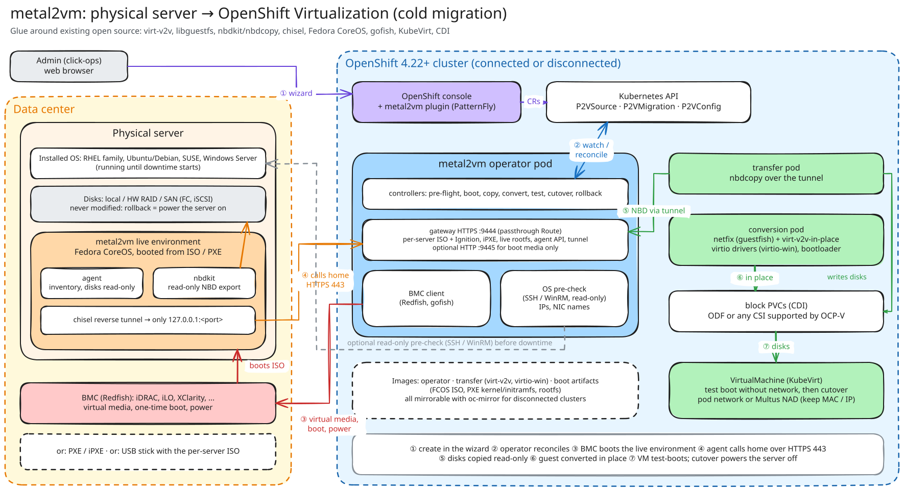
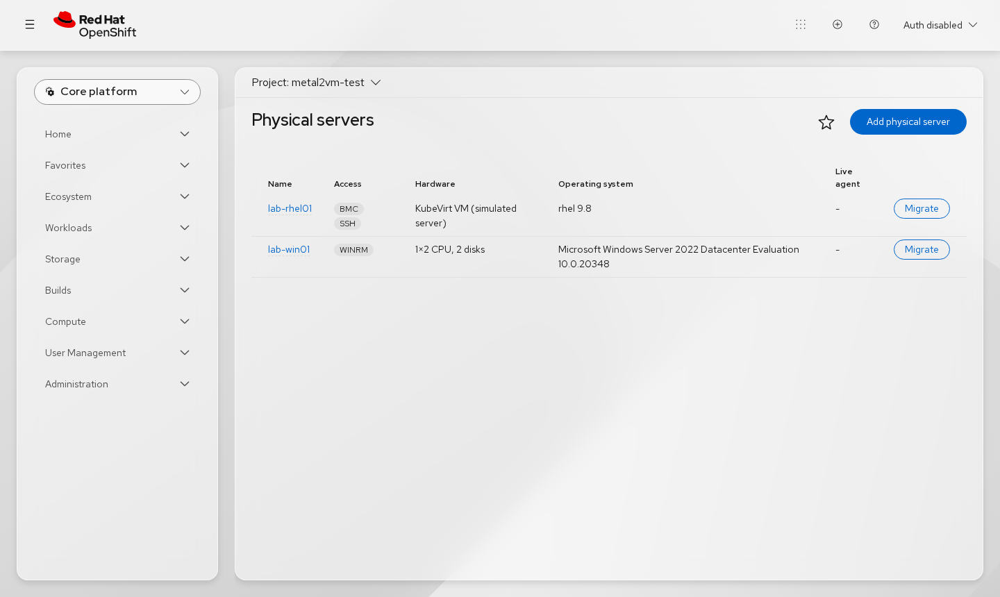
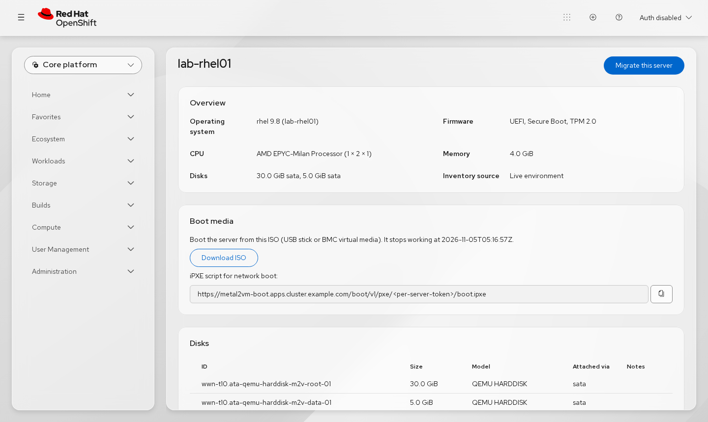
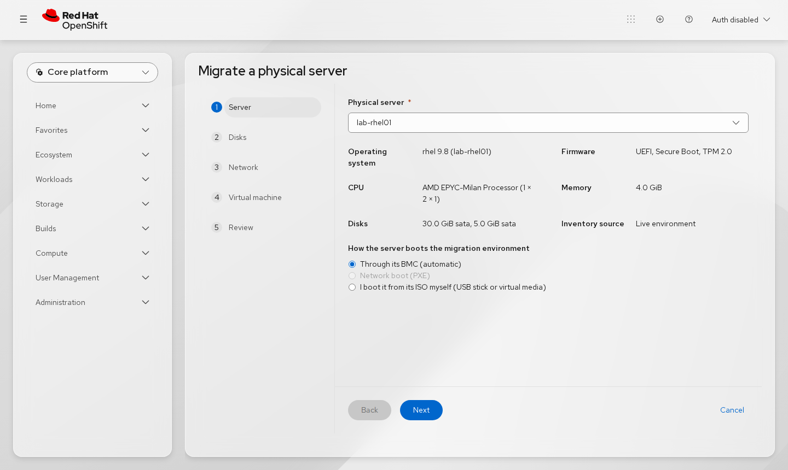
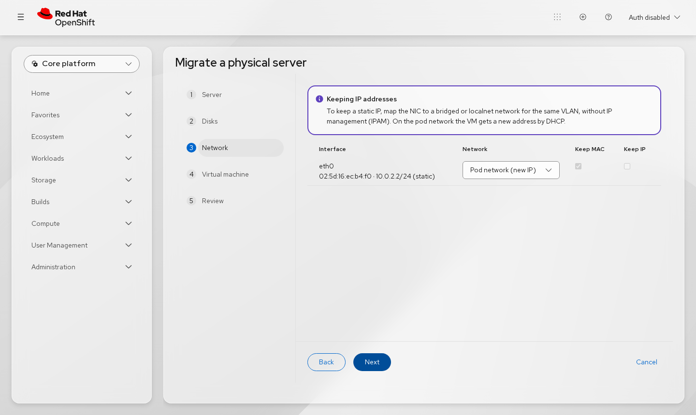
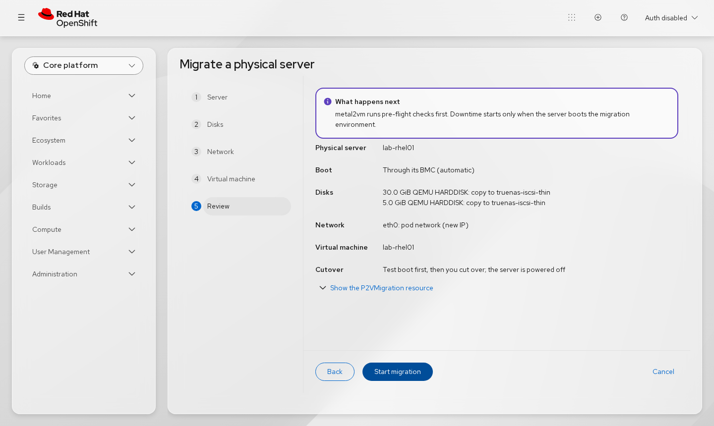
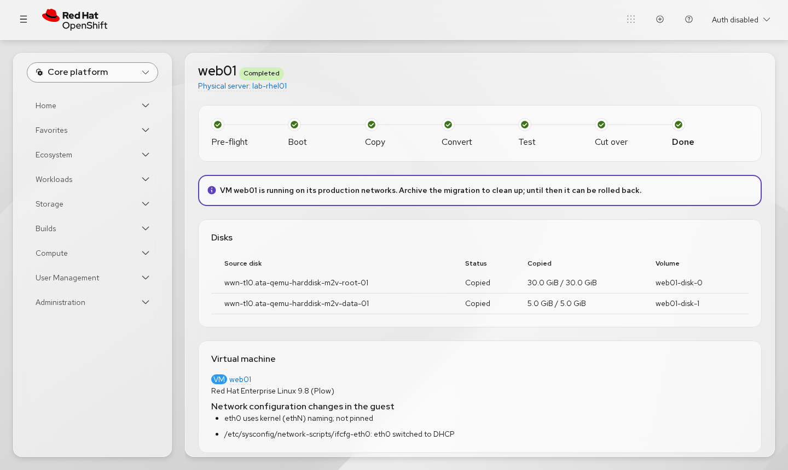

# metal2vm

**Migrate physical servers to virtual machines on OpenShift Virtualization, from the OpenShift web console.**

[](https://github.com/metal2vm/metal2vm/actions/workflows/test.yml)
[](https://github.com/metal2vm/metal2vm/actions/workflows/lint.yml)
[](https://github.com/metal2vm/metal2vm/actions/workflows/console-plugin.yml)
[](https://github.com/metal2vm/metal2vm/actions/workflows/test-e2e.yml)
[](LICENSE)

metal2vm moves a Linux or Windows server from bare metal into a KubeVirt
virtual machine. An admin does it alone, in the console: pick the server, choose
what happens to each disk and network card, start, check the VM, cut over. The
physical server's disks are only ever read, so rolling back means powering the
server on again.

**▶ Demo (4½ min, narrated):**


https://github.com/user-attachments/assets/870a490a-e72d-442c-b92c-5c220135bcbd


> [!NOTE]
> **Status: alpha.** The cold-migration path works end to end on a lab
> OpenShift 4.22 cluster. RHEL 9 and Windows Server 2022 were migrated from
> simulated physical servers: KubeVirt VMs with SATA disks, an Intel e1000e NIC,
> UEFI with Secure Boot, and a Redfish BMC emulator. **It has not yet been tested
> on real hardware.** Reports from real servers are very welcome. See
> [what works](#feature-status).

## Highlights

- **Click-ops in the OpenShift console.** A wizard and a progress page under
  *Virtualization*, with no YAML needed. Everything is also a plain CR, so `oc`
  and GitOps work too.
- **The source is never modified.** Disks are exported read-only from a live
  environment in RAM. Until a migration is archived, rollback powers the server
  back on.
- **Boots servers for you.** Through the BMC (Redfish virtual media: iDRAC, iLO,
  XClarity, ...) or PXE/iPXE. Without either, the admin boots a per-server ISO
  from a USB stick.
- **Test before cutover.** The VM first boots without network. At cutover,
  metal2vm powers the server off (confirmed through the BMC) and starts the VM
  on its production networks.
- **Keeps network identity.** The pod network gives a new address by DHCP. A
  bridged/localnet network can keep the MAC and static IP. The guest's network
  config is adapted, and every change is listed.
- **Firewall- and disconnected-friendly.** The server only calls out over HTTPS
  443, through an authenticated reverse tunnel. All images can be mirrored with
  `oc-mirror`.
- **Glue, not reinvention.** Built on virt-v2v, libguestfs, nbdkit/nbdcopy,
  Fedora CoreOS, chisel, gofish, KubeVirt and CDI.

## How it works



1. **Create** the migration in the wizard; it becomes a `P2VMigration` CR.
2. The operator runs **pre-flight** checks: inventory, storage, networks, risks
   such as encrypted disks.
3. The server **boots the metal2vm live environment** (Fedora CoreOS) through
   its BMC, PXE or a USB stick.
4. The agent there **calls home over HTTPS 443** and exposes the disks read-only
   (nbdkit) through a reverse tunnel.
5. A transfer pod **copies the disks** with `nbdcopy` into block PVCs.
6. A conversion pod **converts the guest in place**: network fix-up, then
   `virt-v2v-in-place` (virtio drivers, bootloader).
7. The VM **test-boots** without network; then you **cut over**, or roll back.

Details are in [docs/DESIGN.md](docs/DESIGN.md).

## Screenshots

| | |
|---|---|
|  |  |
| **Physical servers**, with how each can be reached | **Server details**: hardware, boot ISO, iPXE URL |
|  |  |
| **Wizard**: server and boot method | **Wizard**: network per NIC, keep MAC/IP |
|  |  |
| **Wizard**: plain-language review | **Migration**: progress, disks, guest network changes |

## Feature status

| Area | Status |
|---|---|
| Cold migration (copy while the server is down) | ✅ Working |
| Warm migration (copy while it runs, short cutover) | ⏳ Planned (phase 2) |
| Linux: RHEL family | ✅ Verified with RHEL 9 |
| Linux: Ubuntu / Debian / SUSE | 🧪 Supported by virt-v2v and the network fix-up, not yet tested here |
| Windows Server | ✅ Verified with Windows Server 2022 (virtio-win drivers bundled) |
| Firmware: UEFI (incl. Secure Boot) and BIOS | ✅ UEFI verified, BIOS supported |
| Boot: Redfish BMC, PXE/iPXE, USB/ISO | ✅ Working (Redfish tested with an emulator) |
| Disks: copy to any storage class, or skip | ✅ Working |
| Disks: re-attach SAN LUNs (FC/iSCSI) instead of copying | ⏳ In the API and UI, blocked by pre-flight until implemented |
| Network: pod network, Multus (bridge/localnet), keep MAC/IP | ✅ Working |
| Console plugin (servers, wizard, progress, cutover, rollback) | ✅ Working |
| Packaging: OLM bundle and catalog, Helm chart, YAML, `oc-mirror` configs | ✅ Published ([v0.1.0](https://github.com/metal2vm/metal2vm/releases/tag/v0.1.0)) |

## Requirements

- OpenShift 4.22+ with OpenShift Virtualization. Plain Kubernetes with KubeVirt
  is not supported yet, because the gateway is exposed through an OpenShift Route
  (LoadBalancer/NodePort exposure is planned). The operator still starts there
  and reports what is missing.
- A storage class that provides block-mode PVCs for VMs: ODF or any CSI driver
  supported by OpenShift Virtualization.
- From the physical server: outbound HTTPS (443) to the cluster's ingress. From
  the cluster: the BMC (for Redfish) and, optionally, SSH or WinRM to the running
  OS for the read-only pre-check. See
  [required network flows](docs/DESIGN.md#39-required-network-flows-included-in-the-docs).

## Install

| Method | Command / steps |
|---|---|
| **OperatorHub (OLM)** | Add the catalog `ghcr.io/metal2vm/metal2vm-operator-catalog`, then install **metal2vm** from the console |
| **Helm** | `helm install metal2vm oci://ghcr.io/metal2vm/charts/metal2vm -n metal2vm-system --create-namespace` |
| **YAML** | `oc apply --server-side -f` the release's `install.yaml` |

The operator creates what else it needs: its settings (`P2VConfig` named
`cluster`), the SCC for its conversion pods, and the console plugin
registration. Full instructions are in **[docs/install.md](docs/install.md)**.
Disconnected clusters are covered in **[docs/disconnected.md](docs/disconnected.md)**,
with ready-made `oc-mirror` configurations.

To build everything on your own cluster instead (development):

```sh
git clone https://github.com/metal2vm/metal2vm && cd metal2vm
hack/openshift-dev-deploy.sh all    # build images on the cluster; deploy operator + console plugin
```

Then, in the console: **Virtualization → Physical servers → Add physical
server**, and **Migrate**.

**No spare server?** Use a KubeVirt VM that plays a physical server, and a
Redfish emulator as its BMC:

```sh
hack/lab-source-vm.sh create lab-rhel01 rhel9   # or: win2k22
hack/lab-redfish.sh deploy                      # prints the BMC address and credentials
```

## Development

The only thing you need on your machine is **podman** (or docker). The Go and
Node toolchains run in pinned containers:

```sh
hack/toolbox.sh make test             # generate, vet, unit + envtest (Go)
hack/toolbox.sh make lint             # golangci-lint
make plugin-test plugin-lint          # console plugin tests and lint (Node 22)
make plugin-build                     # console plugin production build
hack/toolbox.sh make catalog build-installer   # OLM bundle + catalog, dist/install.yaml
```

If Go is installed locally, the usual `make test` / `make build` work as well.

| Path | Contents |
|---|---|
| `api/v1alpha1/` | CRDs: `P2VSource`, `P2VMigration`, `P2VConfig` (`migration.metal2vm.io`) |
| `cmd/`, `internal/` | Operator, live agent, transfer/conversion, gateway, BMC, network fix-up, VM builder |
| `console-plugin/` | OpenShift console dynamic plugin (React, PatternFly 6) |
| `images/` | Transfer (virt-v2v, virtio-win) and boot-artifacts (Fedora CoreOS) images |
| `config/` | Kustomize manifests: `default` (operator), `openshift` (+ console plugin), `manifests` (OLM CSV base) |
| `bundle/`, `catalog/`, `dist/` | Generated OLM bundle and catalog, `install.yaml`, Helm chart (`dist/chart`) |
| `docs/` | [Install](docs/install.md), [disconnected](docs/disconnected.md), [releasing](docs/releasing.md), [design](docs/DESIGN.md) |
| `hack/`, `test/lab/` | Developer and lab scripts (lab source VMs, Redfish emulator) |

## Relationship to Forklift / MTV

metal2vm is standalone today. Its CRDs and pipeline are designed so that it
could later become a source provider for [Forklift](https://github.com/kubev2v/forklift)
(the upstream of the Migration Toolkit for Virtualization). See
[DESIGN.md §10](docs/DESIGN.md#10-relationship-to-forklift--mtv-option-c).

## Contributing

Issues and pull requests are welcome. Results from real hardware help the most:
server model, BMC, RAID controller and source OS, whether it worked or not.

## License

Apache License 2.0. See [LICENSE](LICENSE), [NOTICE](NOTICE) and
[THIRD_PARTY_LICENSES.md](THIRD_PARTY_LICENSES.md).

metal2vm is an independent project and is not affiliated with or endorsed by
Red Hat or the CNCF. "OpenShift" is a trademark of Red Hat, Inc.
